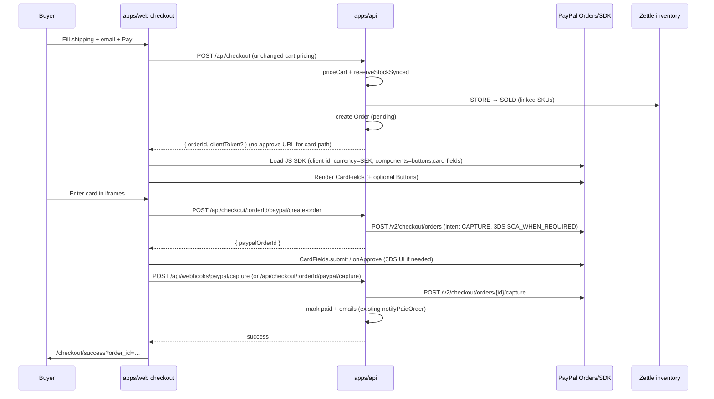

# Build plan: PayPal Advanced Checkout (on-site Card Fields)

**Status:** planned — do not implement until product review  
**Stack:** `apps/api` (Hono) + `apps/web` (Vite React) + Orders v2 CAPTURE + Zettle stock sync  
**Today:** redirect to PayPal hosted checkout (`approve` URL)  
**Goal:** Pay with card **on onemorerip.cards** (branded fields) + keep PayPal wallet as a button option

Official docs (read before build):

- [Set up advanced credit and debit card payments](https://developer.paypal.com/docs/checkout/advanced/)
- [Integrate card payments (JS SDK)](https://developer.paypal.com/docs/checkout/advanced/integrate/)
- [Card Fields (Expanded / v6 path)](https://developer.paypal.com/expanded/card-fields)
- [3D Secure — Card Fields SDK](https://developer.paypal.com/platforms/checkout/advanced/customize/3d-secure/sdk)
- [3D Secure — Orders API](https://developer.paypal.com/platforms/checkout/advanced/customize/3d-secure/api)
- [Eligibility / PSD2](https://developer.paypal.com/expanded/eligibility)
- Orders v2: prefer `payment_source.*.experience_context` over deprecated top-level `application_context` / `payer`

---

## 1. Why change

Current Standard redirect UX:

1. Leave shop → PayPal login wall  
2. “Debit or Credit Card” → guest email again  
3. Card form often defaults country to **United States**

Advanced Checkout (Card Fields):

- Card number / expiry / CVV rendered in PayPal iframes **on our checkout page**
- We control layout, copy, SE locale cues, and pass SE billing/shipping ourselves
- PayPal Buttons can sit next to cards for wallet users
- EU/Sweden: we must handle **3DS / SCA (PSD2)** explicitly for card payments

Sweden (`SE`) + `SEK` are supported for Mastercard / Visa / Amex under Advanced Card Payments.

---

## 2. Prerequisites (PayPal Dashboard) — do first

Checklist before any code ships to production:

- [ ] Business account has **Advanced Credit and Debit Card Payments** enabled (live + sandbox apps)
- [ ] Developer Dashboard → App → **Features → Accept payments** → enable Advanced Card Payments → Save
- [ ] Sandbox business account can process card fields (auto in many sandboxes; complete onboarding if missing)
- [ ] Live app uses same Client ID / Secret we already map as `PAYPAL_API_KEY` / `PAYPAL_SECRET_KEY`
- [ ] Confirm SEK settlement / currency enabled on the merchant account
- [ ] Privacy copy: PayPal requires disclosing that card data is processed by PayPal (see their Advanced overview — add short notice on checkout)

---

## 3. Architecture decision

**Recommended (phase 1):** hybrid on checkout page

| Method | UX |
| --- | --- |
| **Card Fields** | Primary — on-site card form (fixes guest friction) |
| **PayPal Buttons** | Secondary — wallet / Pay Later if eligible |
| **Redirect fallback** | Keep current approve-URL path behind a flag for emergency rollback |

**Not recommended:** raw card data on our server (PCI nightmare). Always use Card Fields iframes.

**SDK choice:** Prefer **JS SDK v6** for new work if account/docs support our market; otherwise ship with documented **v5 `CardFields` + `Buttons`** (still supported). Decide in spike (Milestone 0).

**Money:** keep integer SEK öre internally; convert with existing `oreToPayPalAmount` only at PayPal edge.

---

## 4. Target payment sequence



Stock rules stay the same:

- Reserve at checkout create  
- Release on abandon / create-order failure / capture decline (reuse `releaseStockSynced`)  
- Success path keeps reserved stock as sold  

---

## 5. Backend changes (`apps/api`)

### Keep

- `POST /api/checkout` — validate cart, `reserveStockSynced`, create DB order  
- Capture settlement → `orders.markPaid` / `notifyPaidOrder` / clear welcome discount  
- `toShippingCountryIso` for SE (never `"Sweden".slice(0,2)`)

### Split payment session creation

Today `createCheckout` immediately creates a PayPal order + returns approve URL. Advanced needs **two steps**:

1. **Our** order + stock reserve (existing)  
2. **PayPal** order id created when the buyer actually pays (Card Fields `createOrder` callback)

### New / adjusted endpoints

| Endpoint | Purpose |
| --- | --- |
| `POST /api/checkout` | Return `{ orderId }` (+ maybe `paypalMode`). For Advanced, **do not require** approve URL. Optional: `paymentFlow: 'advanced' \| 'redirect'`. |
| `GET /api/checkout/paypal/client-config` | Public-ish: `{ clientId, currency: 'SEK', mode }` for SDK script (never secret). |
| `POST /api/checkout/:orderId/paypal/order` | Create PayPal order for pending DB order; attach `payment_session_id`; return `{ paypalOrderId }`. Include purchase_units from DB (re-price guard), shipping, `payment_source.card.attributes.verification.method: SCA_WHEN_REQUIRED` for card path; PayPal wallet uses `payment_source.paypal.experience_context` with `locale: sv-SE`. |
| `POST /api/checkout/:orderId/paypal/capture` | Capture by PayPal order id; idempotent; same settlement as current webhook/success capture. |
| Existing success/webhook capture | Keep for Buttons redirect / legacy; share one `settlePayPalCapture(orderId, paypalOrderId)` helper. |

### `PaymentService` refactor

- `createCheckoutRedirect(order)` — current behavior (flagged)  
- `createPayPalOrderForAdvanced(order, { method: 'card' \| 'paypal' })` — Orders API create without forcing approve navigation for card  
- `captureOrder` — already exists; centralize liability-shift checks for card  

### Env

```bash
# existing
PAYPAL_API_KEY=
PAYPAL_SECRET_KEY=
PAYPAL_MODE=live
CHECKOUT_SUCCESS_URL=https://www.onemorerip.cards/checkout/success
CHECKOUT_CANCEL_URL=https://www.onemorerip.cards/cart

# new
VITE_PAYPAL_CLIENT_ID=   # same as PAYPAL_API_KEY; web-only public id
PAYPAL_CHECKOUT_FLOW=advanced|redirect   # kill-switch; default advanced after bake
```

Optional later: browser-safe client token endpoint if using SDK v6 `createInstance` pattern.

### Deprecations to avoid

- Do not send card PAN to our API  
- Prefer `payment_source` + `experience_context` over deprecated `application_context` / `payer` for new payloads  
- Do not use sandbox-only `buyer-country` query param in production SDK URL  

---

## 6. Frontend changes (`apps/web`)

### Checkout page UX

1. Existing address + email form (keep)  
2. After valid cart/address → create our pending order (stock reserved)  
3. Show payment panel:
   - PayPal Buttons container  
   - Card Fields: name, number, expiry, CVV  
   - Billing address: default from shipping; country forced via `toShippingCountryIso` / Sweden  
   - PayPal privacy acknowledgment line  
4. Submit card → SDK `createOrder` → `submit` → `onApprove` → our capture → navigate success  

### Files (expected)

- `components/checkout/checkout-form.tsx` — split “address step” vs “pay step”  
- `components/checkout/paypal-card-fields.tsx` — load SDK, mount fields, wire callbacks  
- `components/checkout/paypal-buttons.tsx` — optional wallet  
- `hooks/use-checkout.ts` / `packages/api-client` — new capture/create-order methods  
- `pages/checkout-success.tsx` — still works if capture already done (idempotent)  

### SDK load (v5 shape — spike may swap to v6)

```html
script src="https://www.paypal.com/sdk/js?client-id=CLIENT_ID&currency=SEK&components=buttons,card-fields&locale=sv_SE"
```

- Load only on checkout route (dynamic script) to avoid bloating other pages  
- Guard `paypal.CardFields().isEligible()` — if false, fall back to redirect button  

### Styling

- Match dark store theme via Card Fields `style` object  
- Mobile-first; single column; clear “Pay now” CTA  

---

## 7. 3D Secure / PSD2 (Sweden / EU)

For **card** payments:

- Create order with  
  `payment_source.card.attributes.verification.method = "SCA_WHEN_REQUIRED"`  
  (or `SCA_ALWAYS` in sandbox while testing)  
- Pass **billing address** (PSD2 recommendation)  
- On approve, inspect `liabilityShift` / authentication result:
  - Proceed when shift is acceptable (`POSSIBLE` / `YES` per PayPal guidance)  
  - Decline/capture-skip on failed auth; release stock  
- SDK Card Fields usually presents the bank challenge UI; API-only path needs `payer-action` redirect — prefer SDK path  

PayPal **wallet** button path: PayPal often handles 3DS; still use `experience_context` with `sv-SE`.

---

## 8. Phased milestones

### M0 — Spike (1–2 days)

- Confirm Advanced Card Payments on **sandbox + live** apps  
- Hello-world page: Card Fields + create/capture against sandbox SEK  
- Decide SDK v5 vs v6  
- **Exit:** eligible card fields render; sandbox capture succeeds with test card + 3DS  

### M1 — API foundation

- Refactor `PaymentService` helpers  
- `POST .../paypal/order` + `.../capture` shared settle  
- Feature flag `PAYPAL_CHECKOUT_FLOW`  
- Tests: mock PayPal; stock reserve/release on decline  
- **Exit:** API tests green; redirect path still works with flag=`redirect`  

### M2 — Web Advanced UI

- Checkout pay step with Card Fields + Buttons  
- Wire api-client  
- Privacy notice  
- **Exit:** sandbox E2E card pay stays on-site; success page settles  

### M3 — Hardening

- liabilityShift matrix  
- INSTRUMENT_DECLINED retry copy  
- Abandon timer still releases Zettle stock  
- Logging without PAN  
- **Exit:** decline/3DS fail/release verified  

### M4 — Production

- Enable Advanced on live app  
- Deploy API then web  
- Flag `advanced` for admins / % rollout  
- Monitor captures + Zettle mismatches  
- **Exit:** live Charmander-sized purchase works; POS qty matches  

### M5 — Remove redirect default

- Redirect only as fallback when `!isEligible()`  
- Delete dead Stripe-era leftovers if any remain  

---

## 9. Test plan

### Sandbox

- [ ] Visa/Mastercard test cards (incl. 3DS challenge cards from PayPal docs)  
- [ ] SEK amounts with shipping + discount breakdown (welcome code)  
- [ ] Swedish shipping address → billing country `SE`  
- [ ] Capture idempotency (double success page)  
- [ ] Decline → stock restored in DB + Zettle  
- [ ] PayPal Button path still works  

### Live (small)

- [ ] Real card, low amount (e.g. Charmander Promo)  
- [ ] Confirm Zettle STORE qty −1  
- [ ] Order email + admin order paid  

---

## 10. Rollback

1. Set `PAYPAL_CHECKOUT_FLOW=redirect` (no web rebuild if web reads config from API)  
2. Or revert web deploy; API redirect `createCheckout` remains  
3. Stock: cancelled/failed advanced attempts must call `releaseStockSynced` (same as today)

---

## 11. Risks & open questions

| Risk | Mitigation |
| --- | --- |
| Live account missing Advanced Card Payments | M0 dashboard check before coding UI |
| SDK v6 vs v5 docs churn | Spike decides; pin docs links in PR |
| 3DS liability edge cases | Explicit matrix; fail closed + release stock |
| Double reserve if create-order retried | Idempotent PayPal order per `orderId` / reuse `payment_session_id` |
| Bundle size | Dynamic import SDK only on checkout |
| Guest vs logged-in email | Already collected before pay step — pass into PayPal order |
| Card Fields ineligible in some browsers | Fallback to PayPal Buttons / redirect |

Open questions for build kickoff:

1. Must we support Apple Pay / Google Pay in v1? (nice-to-have; out of scope unless eligible)  
2. Billing address always = shipping, or separate fields?  
3. Keep “redirect-only” forever as fallback or Buttons-only fallback?  

---

## 12. Acceptance criteria (done)

- Buyer can pay with card **without** leaving onemorerip.cards for a PayPal login/guest email wall  
- Country/billing defaults to Sweden for SE addresses  
- SCA/3DS runs when required; failed auth does not mark order paid  
- Zettle stock still reserves at checkout start and releases on failure  
- Existing PayPal wallet users can still pay via Buttons  
- Kill-switch returns to previous redirect flow within one config change  

---

## 13. Suggested kickoff order

1. Dashboard eligibility (sandbox + live)  
2. M0 spike branch  
3. M1 API + flag  
4. M2 UI  
5. Sandbox QA → live canary → full `advanced`  

When ready to build: start at **M0** and treat this doc as the contract; update checkboxes as you go.
