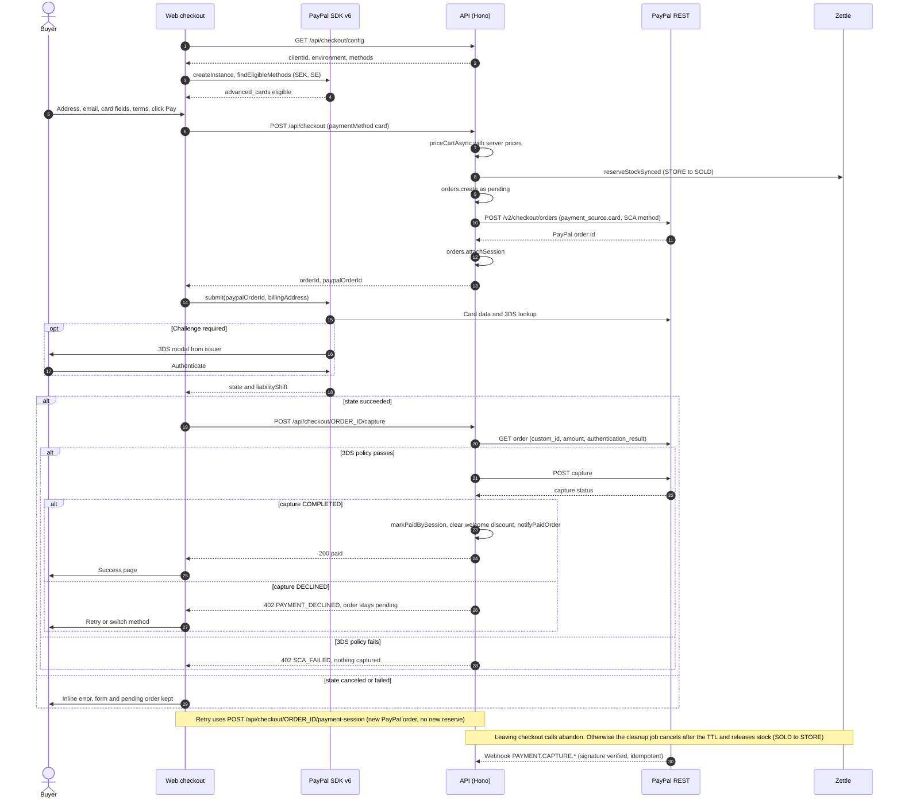

# Build plan: PayPal Advanced Checkout (Card Fields, JS SDK v6)

**Scope:** One More Rip — `apps/api` (Hono), `apps/web` (Vite React), `packages/shared`, `packages/api-client`  
**Researched:** 2026-11-14 against developer.paypal.com (links in section 15)  
**Goal:** card payment on-site (PayPal-hosted iframes in our checkout), PayPal wallet as a second method, current redirect kept as fallback and kill switch.

**Status:** implemented (Phases 0–3) — ship with `PAYPAL_CARD_FIELDS=off|admin|on`; kill switch is API-only

---

## Critical findings in current code (fix before / with Phase 0)

These are exploitable or incorrect **today**, independent of Advanced Checkout:

1. **Unverified webhook (live risk):** `POST /api/webhooks/paypal` never checks PayPal's signature. A forged `PAYMENT.CAPTURE.COMPLETED` carrying an order id as `custom_id` can mark that order paid (guests receive their order id from `POST /api/checkout`).
2. **Declined cards read as paid:** `captureOrder` in `apps/api/src/lib/payments.ts` trusts the PayPal **order** status. PayPal's card-testing sample shows an order `COMPLETED` with its **capture** `DECLINED`, which this code would settle as paid. Decide from `purchase_units[0].payments.captures[0].status`.

---

## 1. Decisions

| Topic          | Decision                                                                                                      | Why                                                                                                                                              |
| -------------- | ------------------------------------------------------------------------------------------------------------- | ------------------------------------------------------------------------------------------------------------------------------------------------ |
| SDK            | JS SDK v6 (`https://www.paypal.com/web-sdk/v6/core`)                                                          | PayPal's integrate guide says v5 "remains supported" and points new integrations to v6.                                                          |
| Card UI        | v6 `card-fields` component (number, expiry, CVV, name)                                                        | Keeps the buyer on our page; card data never touches our code.                                                                                   |
| React binding  | `@paypal/react-paypal-js/sdk-v6` (9.x), loaded only in a lazy checkout chunk                                  | Official wrapper; documents field events (`validitychange`, `cardtypechange`) that the vanilla reference does not.                               |
| SDK auth       | `clientId`, served by our API                                                                                 | The v6 setup page says client ID is recommended and client token is for Fastlane only. The card-fields guide contradicts this (open question 2). |
| Wallet         | v6 `paypal-payments` button, `presentationMode: "auto"` (phase 3)                                             | Popup or modal instead of a full redirect.                                                                                                       |
| Fallback       | Existing server redirect (`approve` URL) stays                                                                | Used when `advanced_cards` is ineligible, the SDK fails to load, or the flag is off.                                                             |
| 3DS            | `SCA_ALWAYS` by default, switchable by env to `SCA_WHEN_REQUIRED`                                             | Advanced card payments carry no PayPal Seller Protection; trading cards are fraud-prone. Liability shift is the main chargeback cover.           |
| Stock          | Reserve at the Pay click, exactly as today                                                                    | Avoids locking stock while the buyer types card details.                                                                                         |
| Order creation | One call creates our order and the PayPal order; a separate endpoint creates a fresh PayPal order for retries | No second stock reservation on retry.                                                                                                            |

Not chosen:

- **v5 `CardFields` or legacy `HostedFields`:** older path; v5 needs the script-URL configuration.
- **Sending card numbers through our API:** the Orders reference says this requires PCI SAQ D.
- **`paypal-guest-payments`** (PayPal-hosted card overlay): possible later fallback if vetting is refused; eligibility in Sweden unverified.

## 2. Prerequisites and Dashboard checklist

Do these before writing UI code. The first item can block the whole project.

- [ ] **Live account approved for Advanced Credit and Debit Card Payments.** Developer Dashboard → Apps & Credentials → **Live** → the app → Features → Accept payments. PayPal's go-live steps say to "complete production onboarding" and "request" the capability; their comparison table lists vetting and underwriting as required. Sandbox approval does not carry over.
- [ ] Same check on the **Sandbox** app. If the sandbox business account was created at sandbox.paypal.com and the capability is off, complete sandbox onboarding.
- [ ] Sandbox business account country is `SE`, with SEK enabled.
- [ ] Create a webhook on both apps pointing at `https://<api>/api/webhooks/paypal`. Record each **Webhook ID** (needed for signature verification).
- [ ] Subscribe to: `PAYMENT.CAPTURE.COMPLETED`, `PAYMENT.CAPTURE.DECLINED`, `PAYMENT.CAPTURE.DENIED`, `PAYMENT.CAPTURE.PENDING`, `PAYMENT.CAPTURE.REFUNDED`, `PAYMENT.CAPTURE.REVERSED`, `CHECKOUT.ORDER.APPROVED`, `CHECKOUT.PAYMENT-APPROVAL.REVERSED`, `CUSTOMER.DISPUTE.CREATED`.
- [ ] Add PayPal's required card privacy notice to checkout and the privacy page (text in section 6).
- [ ] Confirm the owner accepts the PCI scope change: PayPal's card-fields docs reference **SAQ A-EP** (the redirect flow is the lighter SAQ A).
- [ ] Check the account's fee schedule for advanced card versus wallet pricing in Sweden (not researched here).

## 3. Sweden and EU specifics

- **Eligibility:** Sweden is listed for Advanced card payments with Mastercard, Visa and American Express, and SEK is a supported currency.
- **SEK format:** two decimals. `oreToPayPalAmount` (`(ore / 100).toFixed(2)`) is correct. Only JPY and TWD are marked zero-decimal in PayPal's table.
- **PSD2 / SCA:** PayPal's 3DS guide says European merchants may be subject to PSD2 and recommends 3DS plus the cardholder's billing address. Always pass a billing address to `submit()`.
- **Seller Protection:** PayPal's standard-versus-advanced comparison lists protection "for PayPal transactions only" on advanced. Card fraud losses fall on the shop unless 3DS shifted liability.
- **Locale:** keep `sv-SE` in `payment_source.paypal.experience_context.locale` and pass it to the SDK.
- **Privacy:** PayPal requires telling payers that PayPal processes their card data (their wording in section 6).
- **Button wording (general EU consumer law, not from PayPal docs):** the final button should state the obligation to pay. "Pay now" is clearer than the current "Pay securely".
- **Local methods:** card fields do not add Swish or Klarna. That is a separate product decision.

## 4. Deprecated or wrong-context APIs to avoid

| Avoid                                                                                                                                      | Use instead                                                      | Source                                           |
| ------------------------------------------------------------------------------------------------------------------------------------------ | ---------------------------------------------------------------- | ------------------------------------------------ |
| Top-level `payer` on create order                                                                                                          | `payment_source.paypal` (email, name, address)                   | Orders v2 create reference: deprecated since 2.9 |
| Top-level `application_context` (`brand_name`, `locale`, `landing_page`, `shipping_preference`, `user_action`, `return_url`, `cancel_url`) | `payment_source.<source>.experience_context`                     | Orders v2 definitions; v1→v2 guide               |
| `application_context.stored_payment_source`                                                                                                | `payment_source.card.stored_credential`                          | Orders v2 reference                              |
| Verification methods `3D_SECURE`, `AVS_CVV`                                                                                                | `SCA_ALWAYS`, `SCA_WHEN_REQUIRED`                                | `card_attributes` definition                     |
| 3DS fields `liabilityShifted`, `authenticationStatus`, `AuthenticationReason`                                                              | `liability_shift`, `enrollment_status`, `authentication_status`  | 3DS response parameters                          |
| JS SDK v5 `HostedFields`                                                                                                                   | v6 `card-fields`                                                 | Integrate guide                                  |
| v5 `data-client-token` with `/v1/identity/generate-token`                                                                                  | v6 `clientId`                                                    | v6 setup page                                    |
| `PayPal-Auth-Assertion`, `PayPal-Partner-Attribution-Id` headers                                                                           | Omit                                                             | Partner and marketplace only                     |
| Relying on `CHECKOUT.ORDER.COMPLETED`                                                                                                      | `PAYMENT.CAPTURE.COMPLETED`                                      | Event list marks it marketplace/platform only    |
| `CHECKOUT.ORDER.VOIDED` (handled in `webhooks.ts`)                                                                                         | `CHECKOUT.PAYMENT-APPROVAL.REVERSED`, `PAYMENT.CAPTURE.DECLINED` | Not in PayPal's event list                       |

The current `createCheckout` payload already uses `payment_source.paypal.experience_context` and no `payer` or `application_context`. Keep it that way.

**Liability shift values:** `POSSIBLE`, `NO`, `UNKNOWN` — there is no `YES`.

## 5. Backend changes (`apps/api`)

### 5.1 Endpoints

| Method and path                                     | Auth                     | Rate limit | Purpose                                                         |
| --------------------------------------------------- | ------------------------ | ---------- | --------------------------------------------------------------- |
| `GET /api/checkout/config` (new)                    | Public, optional session | none       | SDK and feature config                                          |
| `POST /api/checkout` (changed)                      | Public, optional session | `checkout` | Price, reserve, create our order and the PayPal order           |
| `POST /api/checkout/:orderId/payment-session` (new) | Order access rule        | `checkout` | Fresh PayPal order for a pending order (retry or method switch) |
| `POST /api/checkout/:orderId/capture` (new)         | Order access rule        | `checkout` | Verify, apply 3DS policy, capture, settle                       |
| `POST /api/webhooks/paypal/capture` (existing)      | —                        | —          | Thin alias to the new capture logic during migration            |
| `POST /api/webhooks/paypal` (changed)               | PayPal signature         | none       | Verified, idempotent settlement                                 |
| `POST /api/orders/:id/abandon` (existing)           | Order access rule        | —          | Unchanged; also called when leaving checkout                    |

"Order access rule" is `canAccessOrder` in `routes/orders.ts`: a guest order id is a capability token, and account orders need the owning session. Export it and reuse it.

**`GET /api/checkout/config`**

```json
{
  "provider": "paypal",
  "environment": "sandbox",
  "clientId": "<PAYPAL_API_KEY>",
  "currency": "SEK",
  "locale": "sv-SE",
  "methods": { "cardFields": true, "paypalButton": false, "redirect": true }
}
```

- In mock mode return `provider: "mock"` and all methods false except `redirect`.
- `methods.cardFields` follows `PAYPAL_CARD_FIELDS` (`off`, `admin`, `on`). In `admin` mode it is true only for admin sessions (live canary).
- The client ID is safe to expose per PayPal's setup page. The secret never leaves the API.

**`POST /api/checkout`**

Request: the existing `checkoutInputSchema` plus `paymentMethod: 'card' | 'paypal' | 'redirect'`, defaulting to `redirect` so old clients keep working.

```json
{ "orderId": "ord_…", "paypalOrderId": "5O190127TN364715T", "url": null }
```

- `redirect` behaves exactly as today and returns `url`.
- `card` and `paypal` return `paypalOrderId` with no `url`.
- Mock mode settles immediately and returns the local success `url`, as today.
- Pricing, `reserveStockSynced`, `orders.create` and the failure path (`releaseStockSynced` plus cancel) are unchanged.

**`POST /api/checkout/:orderId/payment-session`**

Request `{ "paymentMethod": "card" | "paypal" | "redirect" }`; response as above.

1. Load the order. Require `status === 'pending'`, else 409.
2. If a previous PayPal order exists, GET it. If it is already captured, settle it and return `{ status: "paid" }` instead of creating another. This prevents double charges.
3. Create a new PayPal order from the stored order lines. Do not re-price and do not re-reserve.
4. `orders.attachSession` overwrites the old id (`payment_session_id` is unique per order, so this is safe).

**`POST /api/checkout/:orderId/capture`**

Request `{ "paypalOrderId": "…" }`.

1. Load the order and apply the access rule.
2. If already `paid` or `fulfilled`, return 200 (idempotent).
3. Require `order.paymentSessionId === paypalOrderId`, else 409 `ORDER_MISMATCH`.
4. `GET /v2/checkout/orders/{id}`. Verify `purchase_units[0].custom_id === order.id`, currency `SEK`, and amount equal to `order.total`.
5. If `payment_source.card` is present, apply the 3DS policy (section 7). On failure return 402 `SCA_FAILED` without capturing.
6. `POST /v2/checkout/orders/{id}/capture` with `PayPal-Request-Id: capture-<paypalOrderId>`.
7. Decide on `purchase_units[0].payments.captures[0].status`, not the order status:

| Capture status                                                 | Action                                                                      | Response                                            |
| -------------------------------------------------------------- | --------------------------------------------------------------------------- | --------------------------------------------------- |
| `COMPLETED`                                                    | `markPaidBySession`, `clearWelcomeDiscountAfterPurchase`, `notifyPaidOrder` | 200 `{ ok: true, status: "paid" }`                  |
| `PENDING`                                                      | Leave pending; the webhook finalises                                        | 202 `{ status: "pending", code: "PENDING_REVIEW" }` |
| `DECLINED` or `FAILED`, or a 422 such as `INSTRUMENT_DECLINED` | Leave pending for retry; log `processor_response.response_code`             | 402 `{ code: "PAYMENT_DECLINED", retryable: true }` |

8. If the capture completed but the order was cancelled in the meantime (abandon or cleanup race): try `reserveStockSynced` again. If it succeeds mark the order paid; if not, refund through `refundOrder` and return 409.

**`POST /api/webhooks/paypal`**

- Verify every event before acting. Read the raw body with `c.req.text()` first, then either:
  - self-verify: `transmissionId|timeStamp|webhookId|crc32(rawBody)` checked against the cert at `paypal-cert-url` (PayPal's preferred method), or
  - post back to `POST /v1/notifications/verify-webhook-signature` (simpler; does not work for simulator events).
- Invalid signature: log it, return 200, and do nothing. This follows PayPal's sample and avoids retry storms.
- Events:
  - `PAYMENT.CAPTURE.COMPLETED` → settle through `supplementary_data.related_ids.order_id` or `custom_id`.
  - `PAYMENT.CAPTURE.DECLINED` / `DENIED` → leave pending; the cleanup job handles it.
  - `PAYMENT.CAPTURE.REFUNDED` / `REVERSED` → the existing cancel-and-release path.
  - `CHECKOUT.ORDER.APPROVED` → safety net: run the capture logic if the browser died after approval.
  - `CHECKOUT.PAYMENT-APPROVAL.REVERSED` → cancel and release stock.
- Drop the `CHECKOUT.ORDER.COMPLETED` and `CHECKOUT.ORDER.VOIDED` branches.

### 5.2 `PaymentService` (`lib/payments.ts`)

- `createCheckout(order, { method })`. Extract `buildPurchaseUnit(order)` from the current payload (items, breakdown, shipping, `custom_id`) and vary only `payment_source`.

Card:

```json
{
  "intent": "CAPTURE",
  "purchase_units": [{ "…": "same as today" }],
  "payment_source": {
    "card": {
      "attributes": { "verification": { "method": "SCA_ALWAYS" } },
      "experience_context": {
        "return_url": "<CHECKOUT_SUCCESS_URL>?order_id=<id>",
        "cancel_url": "<CHECKOUT_CANCEL_URL>?order_id=<id>"
      }
    }
  }
}
```

- PayPal's 3DS guide says to include both URLs on every 3DS request. Only those two fields are documented for the card `experience_context`; do not send `locale`, `brand_name` or `shipping_preference` there.
- `paypal` and `redirect` keep today's `payment_source.paypal` block.
- Send `PayPal-Request-Id` on create (`<order.id>:<method>:<attempt>`) and on capture. PayPal stores these keys for 6 hours.
- Add `getOrder(paypalOrderId)`, typed to include `payment_source.card.authentication_result`.
- `captureOrder` returns `{ outcome: 'completed' | 'pending' | 'declined', captureId?, responseCode? }` based on the **capture** status. This fixes the bug described at the top.
- Add `verifyWebhook(headers, rawBody)`.
- Make `paypalFetch` throw a typed error carrying `status`, `name`, `details[0].issue` and `debug_id`. Log the debug id; PayPal's production checklist asks for it.
- Extend the `test_paypal_client` stub to cover the `card` method and the new return shapes so API tests stay offline.

### 5.3 Pending-order cleanup job (new)

Nothing currently cancels a pending order unless the buyer lands on the cancel URL. On-site payment adds more ways to walk away (closed 3DS modal, declined card, closed tab), and each leaves stock reserved locally and moved to SOLD in Zettle.

- `lib/pending-orders.ts`: `reapPendingOrders(deps, olderThan)`.
- Add `listPendingOlderThan(date)` to `OrderRepository` (memory and Prisma).
- For each stale online order: GET the PayPal order.
  - Captured → settle as paid.
  - Approved → run the capture logic.
  - Anything else → `cancelOrderAndReleaseStock(deps, id, 'Payment not completed in time.')`.
- Run from `server.ts` on an interval (default every 5 minutes, TTL 30 minutes). Skip under `NODE_ENV=test`.
- If the API ever runs on more than one instance, move this to a Railway cron calling an admin endpoint.

### 5.4 Env vars

| Var                                                  | New | Default      | Notes                                                |
| ---------------------------------------------------- | --- | ------------ | ---------------------------------------------------- |
| `PAYPAL_API_KEY`, `PAYPAL_SECRET_KEY`, `PAYPAL_MODE` | no  | —            | Unchanged                                            |
| `CHECKOUT_SUCCESS_URL`, `CHECKOUT_CANCEL_URL`        | no  | —            | Also used as the card `return_url` / `cancel_url`    |
| `PAYPAL_WEBHOOK_ID`                                  | yes | —            | Required in production; add to `assertProductionEnv` |
| `PAYPAL_CARD_FIELDS`                                 | yes | `off`        | `off`, `admin`, `on`; the kill switch                |
| `PAYPAL_SCA_METHOD`                                  | yes | `SCA_ALWAYS` | or `SCA_WHEN_REQUIRED`                               |
| `PENDING_ORDER_TTL_MINUTES`                          | yes | `30`         | Cleanup threshold                                    |

No new `VITE_` variables. The web app reads everything from `/api/checkout/config`, so switching the flag needs no web rebuild.

## 6. Frontend changes (`apps/web`, shared packages)

### 6.1 Shared and client

- `packages/shared/src/schemas.ts`: add `paymentMethod` to `checkoutInputSchema`.
- `packages/shared/src/types.ts`:
  - `CheckoutSession` becomes `{ orderId; url?: string | null; paypalOrderId?: string; status?: 'pending' | 'paid' }`.
  - Add `CheckoutConfig`, `PaymentMethod`, `CaptureResult`, `PaymentErrorCode`.
- `packages/api-client/src/client.ts`:
  - Add `getCheckoutConfig()`, `createPaymentSession(orderId, input)`, `capturePayment(orderId, input)`.
  - Keep `capturePayPalOrder` for the redirect success page.

### 6.2 Web files

| File                                                          | Change                                                                                                                          |
| ------------------------------------------------------------- | ------------------------------------------------------------------------------------------------------------------------------- |
| `hooks/use-checkout-config.ts` (new)                          | TanStack Query, `staleTime: Infinity`; warm it from the cart page                                                               |
| `store/checkout.ts` (new, Zustand)                            | `{ orderId, paypalOrderId, method, phase, error }`; persist `orderId` in `sessionStorage` so a reload can abandon or resume     |
| `components/checkout/payment-section.tsx` (new, lazy)         | `PayPalProvider` with `clientId`, `environment`, `components`, `pageType="checkout"`, `locale`; method selector (Card / PayPal) |
| `components/checkout/card-payment-fields.tsx` (new)           | `PayPalCardFieldsProvider`, name / number / expiry / CVV fields, validity state                                                 |
| `components/checkout/paypal-wallet-button.tsx` (new, phase 3) | `PayPalOneTimePaymentButton` with `createOrder`, `onApprove`, `onCancel`                                                        |
| `lib/paypal.ts` (new)                                         | The single import point for the PayPal wrapper, so tests mock one module                                                        |
| `components/checkout/checkout-form.tsx`                       | Split validation from submission; branch by method                                                                              |
| `pages/checkout.tsx`                                          | Mount the payment section with `React.lazy` and `Suspense`; the route itself stays eager                                        |
| `pages/checkout-success.tsx`                                  | Keep the `token` capture path for redirect; skip capture when already paid; make the PayPal-receipt sentence conditional        |
| `hooks/use-abandon-checkout.ts`                               | Also abandon a stored pending order when the buyer leaves checkout for the cart                                                 |
| `apps/web/server.mjs`                                         | CSP update (6.4)                                                                                                                |
| `pages/terms.tsx`, privacy copy                               | PayPal notice                                                                                                                   |

Card submit flow in `checkout-form.tsx`:

1. Validate with `checkoutFormSchema` and the terms checkbox, as today. Disable Pay until the card fields report valid.
2. If there is no pending order in the store, call `api.checkout({ …, paymentMethod: 'card' })`. Otherwise call `api.createPaymentSession(orderId, { paymentMethod: 'card' })`.
3. If the cart or address changed since the pending order was created, abandon it and call `api.checkout` again.
4. Call `submit(paypalOrderId, { billingAddress })` with `streetAddress`, `city`, `postalCode` and `countryCode` from `toShippingCountryIso`. Billing equals shipping in v1.
5. Handle the result:
   - `succeeded` → `api.capturePayment(orderId, { paypalOrderId })` → on 200 clear the store and `navigate('/checkout/success?order_id=…')`.
   - `canceled` → inline message; the form and pending order stay.
   - `failed` → show a mapped message; allow retry.
   - 402 from capture → "Your card was declined", and offer the PayPal method.
6. Keep an always-visible "Pay with PayPal instead" action that uses the redirect path. This covers in-app browsers and SDK failures.

When `provider` is `mock`, or `methods.cardFields` is false, or `isEligible('advanced_cards')` is false, render today's single button and the redirect flow. PayPal's card-fields guide warns that the card method "may not appear in the eligibility response yet" and says to integrate defensively.

Required notice next to the Pay button (PayPal's wording):

> By paying with your card, you acknowledge that your data will be processed by PayPal subject to the PayPal Privacy Statement available at PayPal.com.

### 6.3 UI details

- Card field containers need an explicit height; the iframe fills its parent.
- The iframe cannot read our CSS variables. Pass resolved theme colours through the `style` option (`input`, `.invalid`, `:focus`; only the properties PayPal lists are allowed).
- Use a 16px font to prevent iOS zoom, and keep AA contrast.
- Wrap each field in the `@akknerds/ui` `Field` for labels and errors, in a single column.
- Render the name field. Sandbox rejection triggers are typed into it.
- Bundle: the PayPal wrapper sits only in the lazy payment chunk, and the SDK script loads from PayPal at runtime on checkout only. Record the chunk size in the PR.
- Do not put `PayPalProvider` at the app root, even though PayPal suggests it for faster buttons. It would load PayPal on every page.

### 6.4 CSP (`apps/web/server.mjs`)

The current policy would block the SDK. It still lists Stripe and has no PayPal hosts. Change `buildCsp()`:

- `script-src`: add `https://*.paypal.com https://*.paypalobjects.com`; remove `https://js.stripe.com`.
- `connect-src`: add `https://*.paypal.com https://*.paypalobjects.com`; remove `https://api.stripe.com`.
- `frame-src`: add `https://*.paypal.com https://*.paypalobjects.com`; remove both Stripe hosts.
- `img-src` and `style-src` already allow what is needed.
- Leave `Cross-Origin-Opener-Policy: same-origin-allow-popups`; the wallet popup needs it.

PayPal's CSP guidance was written for v5 and also suggests `'unsafe-inline'` or a nonce for scripts. Try without it first. Vite dev does not apply this CSP, so test with `pnpm --filter @akknerds/web build` and `start`.

## 7. 3D Secure handling

- The SDK runs 3DS inside `submit()` and shows the issuer challenge in a modal. No redirect handling is needed on the happy path.
- The client gets `data.liabilityShift`. Treat it as a hint only. The server decides, from `GET /v2/checkout/orders/{id}` → `payment_source.card.authentication_result`.

Server policy, following PayPal's response-parameter table:

| `liability_shift` | `enrollment_status` | `authentication_status` | Action                                              |
| ----------------- | ------------------- | ----------------------- | --------------------------------------------------- |
| `POSSIBLE`        | `Y`                 | `Y` or `A`              | Capture                                             |
| `NO`              | `N`, `U` or `B`     | —                       | Capture (PayPal: continue; liability stays with us) |
| `NO`              | `Y`                 | `N`, `R`, `U` or empty  | Do not capture; ask to retry or use another card    |
| `UNKNOWN`         | any                 | any                     | Do not capture; ask to retry                        |
| absent            | —                   | —                       | Capture and log (3DS did not run)                   |

- Optional strict mode: capture only on `POSSIBLE`. This is an owner decision (open question 6).
- If the page is lost during a challenge, the buyer lands on `return_url` (the success page). That page already calls capture by `orderId` when the order is still pending, and the server policy applies there too.
- Abandoned challenges are caught by the `CHECKOUT.ORDER.APPROVED` webhook or the cleanup job.
- One-time purchases need no `stored_credential` block. PayPal's SCA indicator page lists `ONE_TIME` as the default when it is absent.

## 8. Sequence: order, stock, 3DS, capture



## 9. Testing plan

**API unit tests (Vitest, `createApp(overrides)`, no network)**

- Create-order payload per method: card has `attributes.verification.method` and both URLs, and no `payer` or `application_context`.
- Capture outcomes: completed, pending, order-completed-but-capture-declined, 422 decline.
- Capture guards: wrong `paypalOrderId` → 409; amount or `custom_id` mismatch → 409; already paid → 200 with no second email.
- Every row of the 3DS policy table.
- Payment-session: no second `reserveStock` call; a previously captured order settles instead of creating a new one.
- Webhook: unsigned or badly signed events change nothing; a valid event settles once.
- Cleanup job: stale unpaid order → cancelled and stock released; stale captured order → paid.
- Existing redirect tests pass unchanged with the default `paymentMethod`.

**Web tests (Testing Library)**

- Mock `lib/paypal.ts` and spy on `api.*` as the repo already does.
- Flag off, mock provider, or ineligible → redirect button only.
- Card flow → `checkout`, `submit`, `capturePayment`, navigation to success.
- `canceled` and `failed` keep the form; a retry calls `createPaymentSession`, not `checkout`.
- A 402 from capture shows the decline message.

**Sandbox manual matrix** (set `testBuyerCountry="SE"`, currency SEK)

| Case                     | Card or trigger                                                        | Expect                                   |
| ------------------------ | ---------------------------------------------------------------------- | ---------------------------------------- |
| Plain success            | Visa `4012888888881881`, MC `2223000048400011`, Amex `371449635398431` | Paid; email; Zettle quantity down        |
| 3DS frictionless success | Visa `4868719196829038`                                                | Paid; shift `POSSIBLE`                   |
| 3DS challenge success    | Visa `4868719166101368`, MC `5329879735316929`                         | Modal, then paid                         |
| 3DS challenge failed     | Visa `4868719181895556`                                                | Not captured; retry offered              |
| 3DS unavailable          | Visa `4868719557718580`                                                | Not captured                             |
| Close 3DS modal          | any challenge card                                                     | `canceled`; order pending; retry works   |
| Declines (name field)    | `CCREJECT-REFUSED`, `CCREJECT-IF`, `CCREJECT-EC`, `CCREJECT-CVV_F`     | 402; pending; stock still held           |
| Decline then PayPal      | decline, then switch method                                            | Paid once; one stock reservation         |
| Abandon                  | pay attempt, then leave to cart                                        | Cancelled; stock back in DB and Zettle   |
| Timeout                  | close the tab mid-flow                                                 | Cleanup job cancels after the TTL        |
| Double capture           | repeat the capture call                                                | Second call 200; no duplicate email      |
| Discount and shipping    | welcome code plus paid shipping                                        | PayPal breakdown equals the order total  |
| Refund                   | admin refund                                                           | Still works for card captures            |
| Webhooks                 | simulator, then real sandbox events                                    | Verified; idempotent                     |
| CSP                      | production build served by `server.mjs`                                | No CSP errors; fields render             |
| Devices                  | iOS Safari, Android Chrome, one in-app browser                         | Fields usable; fallback button reachable |

The 3DS card numbers are from the first set on PayPal's 3DS test page. The page groups them by country tab and has no Sweden tab, so confirm the set when testing.

**Live**

1. `PAYPAL_CARD_FIELDS=admin`: one real low-value card order as admin, then refund it.
2. Check the Zettle quantity, the order email, the admin order view and webhook delivery.
3. Switch to `on`.

## 10. Migration and rollback

**Migration**

- Phase 0 ships independently of any buyer-facing change.
- The API deploys before the web app. New endpoints are additive, and `paymentMethod` defaults to `redirect`.
- The web app ships with the flag `off`. Behaviour is identical to today until the flag changes.
- `/api/webhooks/paypal/capture` and the `token` success-page path stay. The redirect fallback needs them.
- No database migration. `payment_session_id` already holds the PayPal order id.

**Rollback**

1. Set `PAYPAL_CARD_FIELDS=off` on the API. The web app falls back to redirect on the next config fetch, with no rebuild.
2. Pending orders created by the card flow are cancelled by the cleanup job, and stock is released.
3. If the web deploy itself is bad, revert it. The API remains backward compatible.
4. Do not roll back webhook verification or the capture-status fix.

## 11. Risks

| Risk                                                 | Mitigation                                                                          |
| ---------------------------------------------------- | ----------------------------------------------------------------------------------- |
| Live vetting delayed or refused                      | Check in phase 0; redirect stays; evaluate `paypal-guest-payments`                  |
| Card fraud and chargebacks without Seller Protection | `SCA_ALWAYS`; server liability policy; billing address always sent; dispute webhook |
| PCI scope rises to SAQ A-EP                          | Strict CSP; SDK loaded only from PayPal; owner sign-off                             |
| Stock locked by abandoned attempts                   | Cleanup job; abandon on leaving checkout                                            |
| Money captured after the order was cancelled         | Re-reserve or auto-refund branch in capture                                         |
| Double charge on retry                               | Check the previous PayPal order before creating a new one; request ids              |
| Forged webhooks                                      | Signature verification                                                              |
| CSP blocks the SDK in production only                | Test against `server.mjs` before release                                            |
| v6 documentation is inconsistent                     | Pin the wrapper version; sandbox run of the full matrix                             |
| 3DS modal fails in in-app browsers                   | Always-visible redirect fallback                                                    |
| Cleanup job on several API instances                 | Cancel is already idempotent; move to cron if scaled out                            |

## 12. Open questions

1. Is the live Swedish business account already approved for Advanced card payments? This sets the calendar.
2. Client ID or client token for card fields? The v6 setup page (Oct 2026) and JS reference say client ID; the card-fields guide (June 2026) uses a browser-safe token. Plan: try client ID in sandbox first. If it fails, add `GET /api/checkout/client-token` using `POST /v1/oauth2/token` with `response_type=client_token`. The token is described as expiring after 15 minutes.
3. Can `submit()` be retried on the same PayPal order after `failed` or `canceled`? Undocumented. The plan creates a new PayPal order per attempt.
4. Does `CHECKOUT.ORDER.APPROVED` fire for card-field orders after 3DS? If not, the cleanup job is the only safety net.
5. SDK locale format: the JS reference says BCP-47 (`sv-SE`), the React example shows `en_US`.
6. Strict liability policy (capture only on `POSSIBLE`), or follow PayPal's table?
7. Does `@paypal/react-paypal-js` 9.x accept React 19 as a peer? If not, write a small loader around `window.paypal.createInstance`.
8. Billing address always equal to shipping in v1?
9. Apple Pay and Google Pay (v6 has components for both) — out of scope for v1?

## 13. Phased milestones

Effort figures are rough estimates.

**Phase 0 — Hardening and prerequisites (1–2 days; no buyer-facing change)**

- Dashboard checklist; webhook ids recorded.
- Webhook signature verification; `PAYPAL_WEBHOOK_ID` enforced in production.
- Capture-status fix; typed PayPal errors; request ids.
- Capture guards (session match, amount, `custom_id`).
- Pending-order cleanup job.
- CSP: PayPal hosts added, Stripe removed.

Acceptance:

- [ ] A forged webhook leaves the order unchanged (test).
- [ ] An order-completed, capture-declined response does not mark the order paid (test).
- [ ] A stale pending order is cancelled and its stock restored in DB and Zettle (test plus one sandbox check).
- [ ] Redirect checkout works end to end in sandbox with the new CSP on the production server.
- [ ] Live vetting status is known.

**Phase 1 — API for on-site payment (about 2 days)**

- `GET /api/checkout/config`; `paymentMethod` on `POST /api/checkout`.
- `payment-session` and `capture` endpoints; 3DS policy; shared types; api-client methods.

Acceptance:

- [ ] API tests in section 9 pass; `pnpm test` and `pnpm typecheck` are green.
- [ ] A scripted sandbox run creates a card order and returns a `paypalOrderId` with no `url`.
- [ ] The redirect path is unchanged when `paymentMethod` is omitted.

**Phase 2 — Card fields UI behind the flag (2–3 days)**

- Lazy payment section; card fields; submit flow; error states; privacy notice; fallback button.

Acceptance:

- [ ] The sandbox matrix passes for all card rows.
- [ ] The buyer never leaves the site on the card path, and no email is requested twice.
- [ ] With the flag `off` the page behaves and looks as it does today.
- [ ] The main bundle does not grow; payment chunk size is recorded.
- [ ] The form is keyboard and screen-reader usable.

**Phase 3 — PayPal wallet button (about 1 day, optional for v1)**

- v6 `paypal-payments` button with `presentationMode: "auto"`; redirect if the popup is blocked.

Acceptance:

- [ ] Wallet payment completes without a full-page redirect on desktop.
- [ ] Cancelling returns to the form with the order still pending.
- [ ] A blocked popup falls back to redirect.

**Phase 4 — Live rollout (calendar depends on vetting)**

- `admin` canary, then `on`. Watch captures, declines, webhook failures and Zettle mismatches for a week.

Acceptance:

- [ ] A real card order as admin is paid, emailed, reflected in Zettle, and refunded.
- [ ] 3DS (BankID or issuer app) completes on a Swedish card.
- [ ] Rollback is rehearsed: flag `off` restores redirect without a deploy.

**Phase 5 — Follow-ups**

- Decide the default SCA mode from real decline and dispute data.
- Evaluate Apple Pay, Google Pay and saved cards.
- Remove leftover Stripe naming (`use-abandon-checkout.ts` comments, the `/webhooks/stripe` stub, the `CheckoutSession` doc comment).

## 14. Definition of done

- A guest can pay by card on the site, with 3DS, in SEK, without visiting paypal.com.
- An order is marked paid only after a server-verified capture with status `COMPLETED`.
- Failed, cancelled or abandoned attempts never leave stock reserved beyond the TTL.
- Webhooks are signature-verified.
- One env change returns the site to the redirect flow.

## 15. Sources

- [Set up advanced credit and debit card payments](https://developer.paypal.com/docs/checkout/advanced/) — eligibility table, privacy notice (Oct 14, 2026)
- [Integrate card payments](https://developer.paypal.com/docs/checkout/advanced/integrate/) — v5 guide with the v6 pointer, account setup (Oct 14, 2026)
- [Card fields (v6)](https://developer.paypal.com/expanded/card-fields) — flow, states, SAQ A-EP, production checklist (Jun 11, 2026)
- [Set up JavaScript SDK v6](https://developer.paypal.com/sdk/js/set-up) — client ID versus client token (Oct 13, 2026)
- [JavaScript SDK v6 reference](https://developer.paypal.com/sdk/js/reference/) — card fields API, eligibility, guest payments (Oct 29, 2026)
- [React SDK v6 reference](https://developer.paypal.com/sdk/react/reference) — provider, card field components and hooks (Aug 17, 2026)
- [Upgrade from v5 to v6](https://developer.paypal.com/v5-v6) (Aug 24, 2026)
- [3D Secure (v6)](https://developer.paypal.com/docs/checkout/advanced/customize/3d-secure/) (Jun 12, 2026)
- [3D Secure: Orders API](https://developer.paypal.com/docs/checkout/advanced/customize/3d-secure/api/) — PSD2 note, `authentication_result` shape
- [3D Secure response parameters](https://developer.paypal.com/docs/checkout/advanced/customize/3d-secure/response-parameters/) — liability table
- [3D Secure test scenarios](https://developer.paypal.com/docs/checkout/advanced/customize/3d-secure/test/)
- [SCA payment indicators](https://developer.paypal.com/docs/checkout/advanced/customize/sca-payment-indicators/)
- [Card testing](https://developer.paypal.com/tools/sandbox/card-testing/) — test cards, rejection triggers, declined-capture sample
- [Orders v2 create order](https://developer.paypal.com/sdk/orders/v2/orders-create) — deprecated `payer` and `application_context`, `PayPal-Request-Id`
- [`card_attributes`](https://developer.paypal.com/api/orders/v2/definitions/card_attributes) — verification methods
- [`paypal_wallet_experience_context`](https://developer.paypal.com/api/orders/v2/definitions/paypal_wallet_experience_context)
- [Orders v1→v2 guide](https://developer.paypal.com/api/rest/integration/orders-api/v1-v2-migration) — `experience_context` per source
- [Integrate webhooks](https://developer.paypal.com/api/rest/webhooks/rest/) — signature verification
- [Webhook event names](https://developer.paypal.com/api/rest/webhooks/event-names/)
- [JS SDK best practices (CSP)](https://developer.paypal.com/sdk/js/v5/best-practices)
- [Move your app to production](https://developer.paypal.com/api/rest/production)
- [Standard versus advanced comparison](https://developer.paypal.com/platforms/checkout) — vetting, Seller Protection (multiparty docs)

---

_Produced from PayPal docs research ([PayPal Advanced Checkout research](13165599-19c6-4944-8a44-d9e6e268c2f7)) + repo-specific checkout/Zettle constraints._
